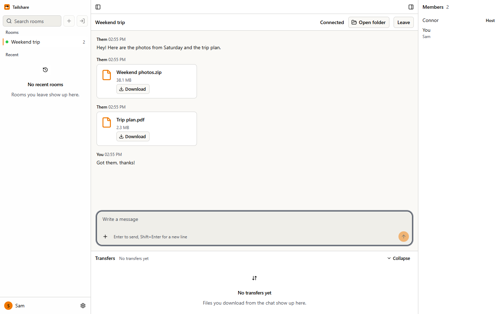
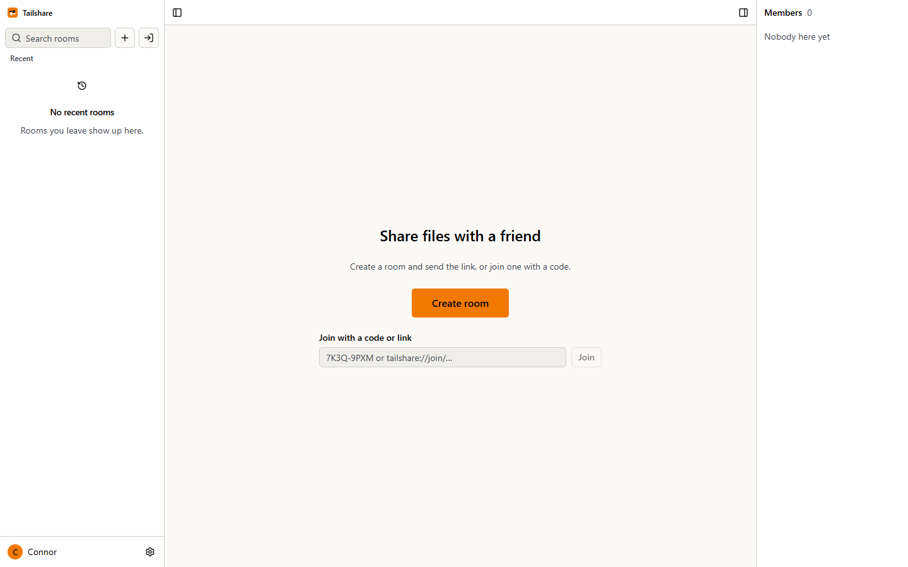
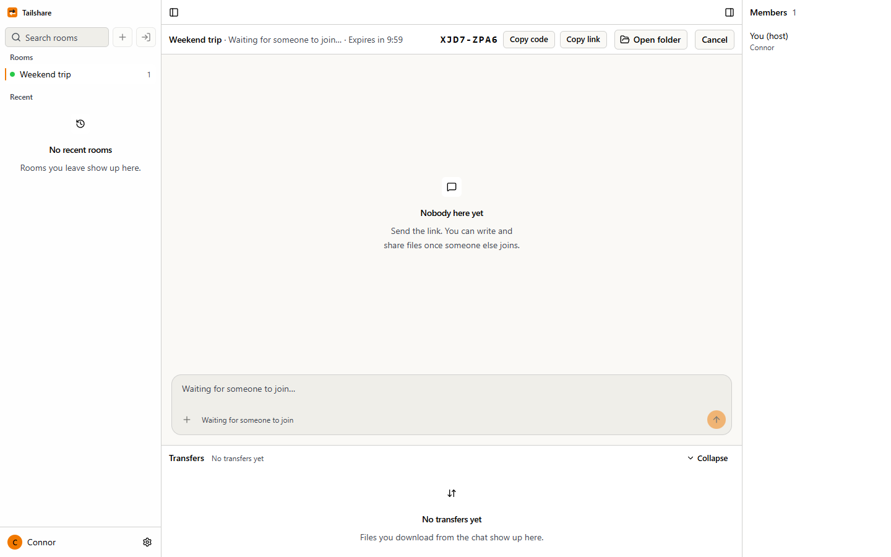
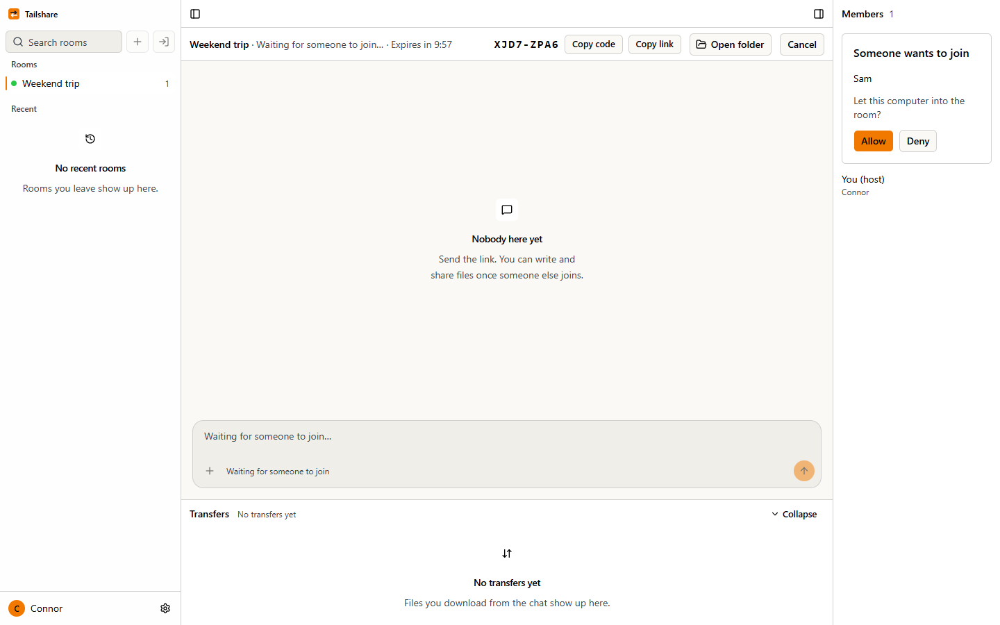
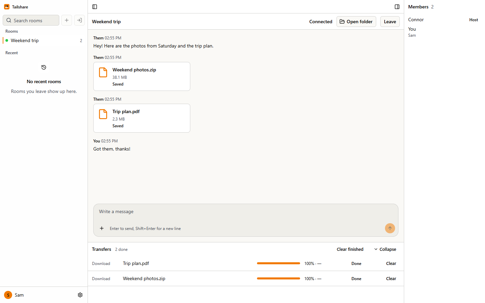
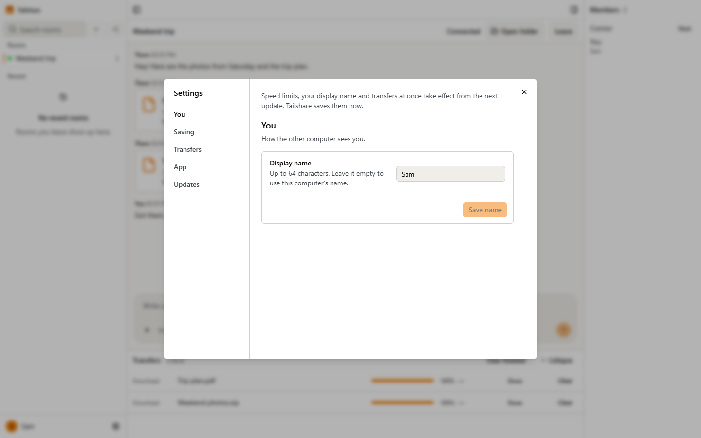

# Tailshare

Share files with friends by sending them a link. Make a room, send the link,
and chat and swap files in one window. No accounts, no cloud storage, no
setup. Files go straight from one computer to the other, end-to-end encrypted
with WireGuard through [Tailcat](https://github.com/tailscale/tailcat).

<picture>
  <source media="(prefers-color-scheme: dark)" srcset="docs/images/04-chat-files-dark.png">
  
</picture>

**[Download for Windows](https://github.com/connor-davis/tailshare/releases/latest)**:
get `Tailshare-Setup-<version>.exe` from the latest release. It installs for
your user only and needs no admin rights. Windows SmartScreen may warn about
an unknown app the first time: choose **More info**, then **Run anyway**.

## How it works

### 1. Make a room

Click **Create room**, or **+** next to the search box. Give the room a name,
or keep the one Tailshare suggests.

<picture>
  <source media="(prefers-color-scheme: dark)" srcset="docs/images/01-home-dark.png">
  
</picture>

### 2. Send the link

The room shows an 8-character code like `7K3Q-9PXM`. **Copy link** copies a
`tailshare://` link: send it in any chat app. Your friend clicks it, or types
the code into **Join**. A code is good for 10 minutes. You can start writing
before anyone arrives.

<picture>
  <source media="(prefers-color-scheme: dark)" srcset="docs/images/02-room-waiting-dark.png">
  
</picture>

### 3. Let them in

When someone joins, their name shows on the right. Click **Allow** to let them
in, or **Deny**. Nobody gets in without your OK. A room holds up to 8 people.

<picture>
  <source media="(prefers-color-scheme: dark)" srcset="docs/images/03-join-request-dark.png">
  
</picture>

### 4. Chat and share files

Write in the box at the bottom. **Enter** sends, **Shift+Enter** starts a new
line. To share files, click **+** or drag them onto the chat. Each file shows
up as a card, and the other side clicks **Download** to get it.

Downloads go to the save folder in Settings (`Downloads\Tailshare` at
first). A name that is already taken gets a number, like `photo (2).jpg`, so
nothing is ever overwritten. A download that stops part-way picks up where it
left off, and every file is checked when it lands.

<picture>
  <source media="(prefers-color-scheme: dark)" srcset="docs/images/06-downloaded-dark.png">
  
</picture>

Chat lives in memory only. It is gone when the room ends and is never saved to
disk. Files you shared stay in the room's folder: **Open folder** shows it.

### 5. Settings

Click the gear at the bottom left. Pick your name, where downloads go, speed
limits, light or dark, and how Tailshare updates.

<picture>
  <source media="(prefers-color-scheme: dark)" srcset="docs/images/08-settings-dark.png">
  
</picture>

## Updates

Tailshare checks for updates on its own. When one is ready, **Update
available** appears at the top: read what's new, then **Download**. You can
also download it from **Settings → Updates**. When the download is done, a
restart icon appears at the top. Click it once your transfers are finished.

Settings can switch to **Nightly** builds to try new things early. They may be
unfinished.

## Privacy

- No accounts and no Tailshare servers. The code is turned into connection
  keys on each computer ([how](docs/security.md)).
- Traffic is encrypted end to end. It goes direct between the computers when
  the networks allow, otherwise through Tailcat's free relays, which only see
  encrypted data.
- A friend can only download files that were shared in the room.
- Chat is never written to disk.

## Develop

Needs Go 1.27, Node.js 22.13+ and [Task](https://taskfile.dev).

```sh
task check      # Go checks and tests, desktop types, lint, formatting and tests
task test       # Go tests (offline)
task test:net   # also run the live relay test (needs internet)
task build      # build bin/tailshare
task web:install # install desktop dependencies
task dev        # launch the desktop shell
task lint:web   # types, lint and formatting
task test:web   # desktop tests
task build:web  # build desktop bundles
task dist       # build the Windows installer into dist/
```

To try a room on one computer, run a second copy with its own profile. A
profile has its own settings and its own single-copy lock:

```sh
task build && task build:web
cd web/apps/desktop && npx electron . --profile=sam
```

## Installer

`task dist` builds an unsigned Windows x64 installer. It installs for the
current user and needs no admin rights. Steps, the SmartScreen warning and
firewall notes are in [web/apps/desktop/README.md](web/apps/desktop/README.md).
The releases page also has a Linux AppImage and unsigned macOS dmgs, and
[docs/headless.md](docs/headless.md) shows how to host or join with no screen.

Start with [docs/start-here.md](docs/start-here.md). The wire format is in
[docs/protocol.md](docs/protocol.md). Agents read [AGENTS.md](AGENTS.md).
